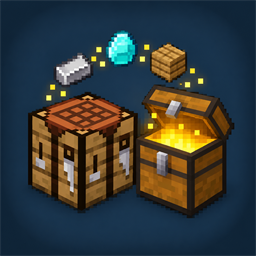
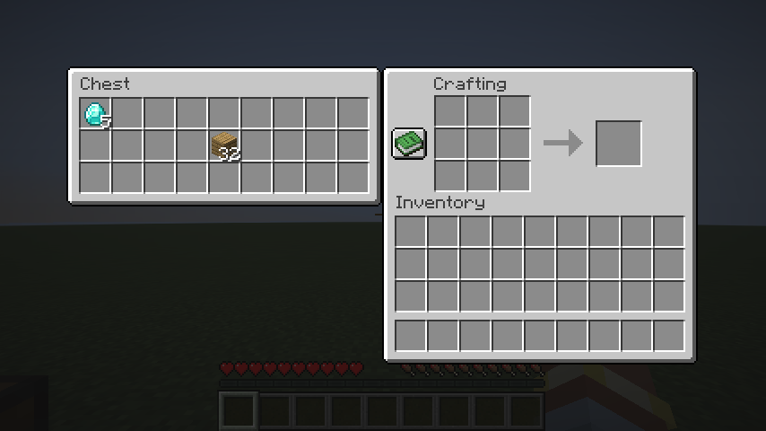

<p align="center"></p>

<h1 align="center">MX Crafting Chest</h1>

<p align="center">
  Place a chest next to your crafting table and its inventory opens right beside the crafting grid.<br>
  Take out what you need, craft, and put the rest back without ever closing the screen.
</p>

<p align="center"></p>

---

## Features

- When a chest stands directly next to a crafting table (north, east, south or west), its inventory is shown to the left of the crafting screen.
- Single chests, double chests, trapped chests, copper chests and barrels work.
- Click, drag and shift-click items between the chest, the crafting grid and your inventory. Shift-clicking an item in the chest moves it to your inventory.
- The recipe book uses the same space, so the chest panel hides while the recipe book is open and comes back when you close it.
- Chests that are locked or can't be opened (a block or cat on top) are skipped, just like when you click them.
- Players without the mod see the normal crafting table. Nothing breaks for them.

## Downloads

Get both jars from [GitHub Releases](../../releases). Pick the release whose version starts with your Minecraft version.

| File | What | Install on |
|---|---|---|
| `MXCraftingChest-<version>.jar` | Fabric mod | every player's client, and the server if it runs Fabric |
| `CraftingChestPaperBridge-<version>.jar` | Paper plugin | the server if it runs Paper |

### Which server needs what

The server decides which slots a menu has, so the chest slots have to be added on the server side:

| Where you play | Server side |
|---|---|
| Singleplayer, LAN world you host | Nothing extra, the mod covers it |
| Fabric server | Install the mod on the server too |
| Paper server (or a fork like Purpur) | Install CraftingChestPaperBridge |
| Vanilla or any other server | Not supported, you get the normal crafting table |

## Requirements

| | |
|---|---|
| Minecraft | 26.3 |
| Client | [Fabric Loader](https://fabricmc.net/) 0.19.0 or newer and [Fabric API](https://modrinth.com/mod/fabric-api) |
| Paper server | [Paper](https://papermc.io) 26.3 |
| Java | 25 |

## Paper plugin configuration

`plugins/CraftingChestPaperBridge/config.yml`:

```yaml
# Only show a chest if the player could also open it by right-clicking it.
# This asks protection plugins (WorldGuard, GriefPrevention, Lands, ...) with a simulated right-click on the chest,
# so a crafting table placed outside a claim cannot be used to reach into a protected chest.
respect-protection: true
```

Without this check anyone could place a crafting table right outside a claim and use it to reach into a protected chest next to it.

> Logging plugins such as CoreProtect may not record items taken through the crafting table as chest transactions.

## How it works

When a crafting table menu opens, the server looks for a chest next to the table and appends its slots to the menu after the 46 vanilla slots. Right before the screen opens, it sends the custom payload `craftingchest:chest_info` (chest size and title) so the client creates the same slots and draws the chest panel. Without that payload the client builds the normal crafting menu.

- **Fabric** (`client-fabric`): mixins on `CraftingMenu` add the slots on both sides. The server only does this for clients that registered the payload channel.
- **Paper** (`server-paper`): the plugin replaces the crafting table menu of players with the mod with its own `CraftingMenu` subclass. Paper builds its click and drag events from an inventory view, so the plugin gives that view a mapping for the extra slots to the chest inventory. Without it, clicks on chest slots would throw and kick the player.

## Building

Building needs JDK 25.

```sh
./gradlew build
```

builds both parts. The jars end up in `client-fabric/build/libs/` and `server-paper/build/libs/`. `client-fabric` and `server-paper` are separate Gradle builds (Fabric Loom and paperweight don't work well in one build), and the root build just runs both. Each folder can also be built on its own with `./gradlew -p client-fabric build`. Local builds are versioned `<minecraft>-dev`.

## Tests

```sh
./gradlew -p client-fabric runClientGameTest
```

starts a game client, creates a world and checks single chests, double chests and no chest, including real slot clicks. Screenshots end up in `client-fabric/build/run/clientGameTest/screenshots/`.

To also test against a Paper server, start a Paper server with the plugin on port 25599 in offline mode with the whitelist off, pipe its console input from a file named `cmds.txt` in the server folder (`tail -f cmds.txt | java -jar paper.jar nogui`) and set `CRAFTINGCHEST_PAPER_DIR` to that folder before running the tests.

## Versioning and releases

Versions have the form **`<minecraft version>-patch-<n>`**, for example `26.3-patch-1`, `26.3-patch-2`, `26.4-patch-1`. Both jars of a release always have the same version.

Releases are made by [GitHub Actions](.github/workflows/build.yml):

| Event | What happens |
|---|---|
| Push to `main` | Build, tag `v<version>`, GitHub release with both jars and a changelog |
| Pull request to `main` | Build only. The jars (`…-pr.<number>`) are attached to the workflow run as an artifact |
| Push that only changes `*.md` files or `docs/` | Nothing |
| Push with only `docs:`/`ci:`/`test:`/`style:` commits since the last release | Build only, no release |

[`.github/scripts/release-info.sh`](.github/scripts/release-info.sh) picks the next version and writes the changelog:

- The Minecraft version comes from `minecraft_version` in `client-fabric/gradle.properties`. `minecraftVersion` in `server-paper/gradle.properties` must be the same, otherwise the build fails. When you change it, the patch number starts again at 1.
- The patch number continues from the highest `v<minecraft>-patch-<n>` tag.
- The changelog lists the commits since the previous release. Commits named in the [Conventional Commits](https://www.conventionalcommits.org) style are grouped: `feat:` under *Features*, `fix:`/`perf:` under *Fixes*. `docs:`, `ci:`, `test:` and `style:` commits are left out. All other commits go under *Changes*.

### Updating for a new Minecraft version

1. `client-fabric/gradle.properties`: `minecraft_version`, `loader_version`, `fabric_api_version` (see [fabricmc.net/develop](https://fabricmc.net/develop/)).
2. `server-paper/gradle.properties`: `minecraftVersion` and `paperBuild` (see [papermc.io/downloads/paper](https://papermc.io/downloads/paper)).
3. Run the game tests. The mixins target `CraftingMenu`, `CraftingScreen` and `AbstractRecipeBookScreen`. The plugin relies on the slot layout of `CraftingMenu` (slots 0-45) and on Paper's `CraftInventoryView`.

## License

[MIT License](LICENSE)
